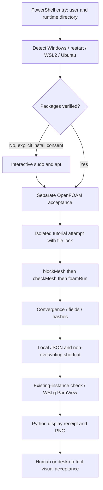

# Architecture / 项目结构

| Path | Responsibility |
|---|---|
| `Install-OpenFOAM.ps1` | Windows orchestration and explicit human handoffs |
| `scripts/windows/Common.ps1` | Native argv quoting, separate stdout/stderr, scalar result, WSL state parsing |
| `scripts/windows/Open-ParaView.ps1` | Reusable launcher using private runtime JSON |
| `scripts/linux/check-ubuntu.sh` | Exact OS/architecture check |
| `scripts/linux/install-packages.sh` | Missing package installation; no blanket upgrade |
| `scripts/linux/foam-exec.sh` | Isolated explicit environment load; restores strict script options |
| `scripts/linux/verify.sh` | Independent installed-environment acceptance |
| `scripts/linux/benchmark.py` | Locks, attempts, solver exit checks, quality checks, result hashes |
| `scripts/linux/launch-viewer.py` | Case/WSLg validation, duplicate detection, launch result wait |
| `scripts/linux/view.py` | Final time, U Magnitude, camera, scalar bar, PNG and JSON receipt |
| `tests/` | Static, fixture and real-host checks |
| `examples/` | Placeholder configuration only; no upstream tutorial copies |
| `.github/workflows/` | Unprivileged static/fixture CI |
| `docs/` | Instructions, provenance, validation boundaries and release gates |

Runtime state belongs outside Git. Windows runtime contains timestamped logs, local configuration, PNG/JSON receipts and possibly a fallback shortcut. Linux runtime contains untouched failed attempts and successful cases. No global state file can override current environment verification.

Recovery means rerunning completed checks and reusing verified outputs. It does not mean continuing an interrupted solver from a partial time directory. A failing step stops subsequent stages. Package-manager interrupted transactions may require a manual `dpkg` repair; scripts never assume permission to change unrelated package state.
